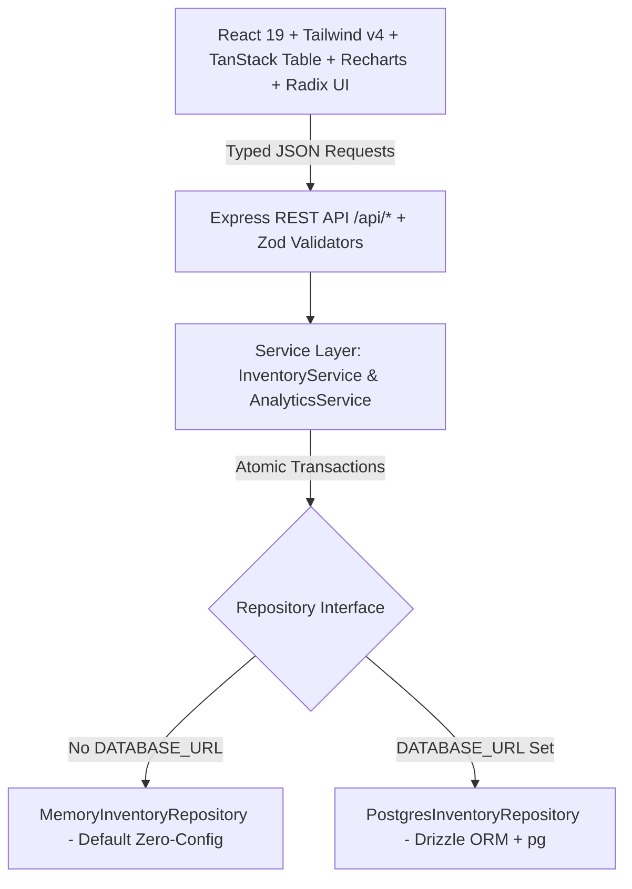

# StockPilot — Inventory Management Platform

StockPilot is a focused, production-grade Inventory Management web application tailored for an Indian electrical & industrial supplies distributor. It delivers crisp vector-first UI rendering across desktop (up to 4K) and mobile, paired with a transactional backend, append-only stock movement ledger, per-item GST calculation (CGST + SGST), and zero-config persistence.

## Screenshots

| View | Preview |
| :--- | :--- |
| Executive Dashboard (Light) | `<!-- Add screenshot: docs/dashboard-light.png -->` |
| Executive Dashboard (Dark) | `<!-- Add screenshot: docs/dashboard-dark.png -->` |
| Stock Ledger & Godown Split | `<!-- Add screenshot: docs/stock-drawer.png -->` |
| Purchase Receiving & Sales GST Sheet | `<!-- Add screenshot: docs/orders-flow.png -->` |

## Core Features

- **Executive Dashboard**: Five animated KPI cards with sparklines and deltas, 30/90-day Sales vs. Purchases area chart, Top-Selling SKUs, Stock by Category donut, Recent Activity timeline, and live **Low-Stock Alerts** with one-click pre-filled PO creation.
- **Stock Inventory & Append-Only Ledger**: 40 electrical & industrial SKUs across 5 categories (`Cables & Wires`, `Switchgear & Protection`, `Industrial Lighting`, `Tools & Instruments`, `Enclosures & Accessories`), server-side search/filter/pagination, "Low stock only" toggle, reasoned stock adjustments, and clickable PO/SO references in the movement history.
- **Purchase Orders**: Create GST-calculated POs, inspect line breakdowns, and execute idempotent **"Mark as received"** flows into any godown (duplicate receipts are blocked with `409 Conflict`).
- **Sales Orders**: Live godown availability per line item, automatic per-item GST (`5%`, `12%`, `18%`) with CGST/SGST summaries, insufficient-stock guards, status timelines, payment updates, and stock-reversing order cancellations.
- **Reports & Exports**: Stock, Sales, and Purchase report tabs with date/category/godown filters, charts, one-click **CSV Export**, and clean **Print / Save PDF** styling.
- **Godowns & Directory**: Warehouse capacity utilization cards, atomic inter-godown transfers (`TRANSFER_OUT` + `TRANSFER_IN`), and searchable Customers & Suppliers directories with GSTINs and totals.
- **Productivity & Polish**: `Cmd/Ctrl+K` Command Palette, Light/Dark themes, and **Reset demo data** inside Settings.

## Architecture



## End-to-End Operational Workflow

1. **Purchase**: Open a Pending PO (or click **Create PO** directly from a Dashboard low-stock alert), select the destination godown, and click **Mark as received**.
2. **Stock**: Godown balances increase atomically, a `PURCHASE_IN` row is appended to `StockMovement`, and the Dashboard low-stock alert count drops immediately.
3. **Sale**: Raise a Sales Order with live per-line godown availability and CGST/SGST calculation. Fulfilling deducts stock (`SALE_OUT`); attempting to oversell returns an explicit error (`Only N units of X available in Y`).
4. **Reversal & Alerts**: Cancelling a fulfilled sale appends a `SALE_CANCEL_REVERSAL` row without mutating history. Whenever a SKU reaches `qty <= minLevel` (`LOW`) or `qty == 0` (`OUT`), it surfaces automatically in the Dashboard alerts panel.

## Local Setup

```bash
# 1. Install dependencies
npm install

# 2. Start full-stack dev server on http://localhost:3000 (zero-config in-memory DB)
npm run dev

# 3. Run unit tests (service invariants, idempotency, rollback, GST math)
npm test

# 4. Type-check and build production bundle
npm run lint
npm run build
```

### Environment Variables

See `.env.example`:

- `DATABASE_URL` *(optional)* — PostgreSQL connection string (e.g., Neon). When empty, StockPilot runs with the deterministic seeded in-memory repository automatically.
- `PORT` — HTTP port (defaults to `3000`).

### Deploying with Neon PostgreSQL

1. Provision a PostgreSQL database on [Neon](https://neon.tech) and copy the pooled `DATABASE_URL`.
2. Push the Drizzle schema defined in `src/server/db/schema.ts` (`npx drizzle-kit push`).
3. Set `DATABASE_URL` in your hosting environment and start with `npm run build && npm start`. On first boot with an empty database, `PostgresInventoryRepository` seeds the 90-day dataset automatically.

## Key Design Decisions

- **Single Transactional Service Layer**: All inventory invariants live exclusively in `src/server/services/inventory.service.ts`; route handlers only parse Zod schemas and map `ServiceError` to `{ error: { code, message } }`.
- **Single Source of Truth for Rules**: `statusFor(qty, minLevel)`, `formatINR()`, and `calculateOrderTotals()` live in `src/lib/format.ts` and are shared identically between client and server.
- **Resolution-Independent 4K Clarity**: Zero raster stock images—every brand mark, icon, sparkline, and chart is pure SVG/CSS on a strict 8px grid with tabular numerals (`JetBrains Mono`).

## What to Build Next

- Role-based access control (Warehouse Operator vs. Procurement Manager vs. Finance)
- Barcode / QR scanning for rapid PO receiving and physical cycle counts
- Automated PDF tax invoice generation with HSN summary tables & E-Way bill JSON export
- Multi-currency vendor imports and landed-cost allocation
